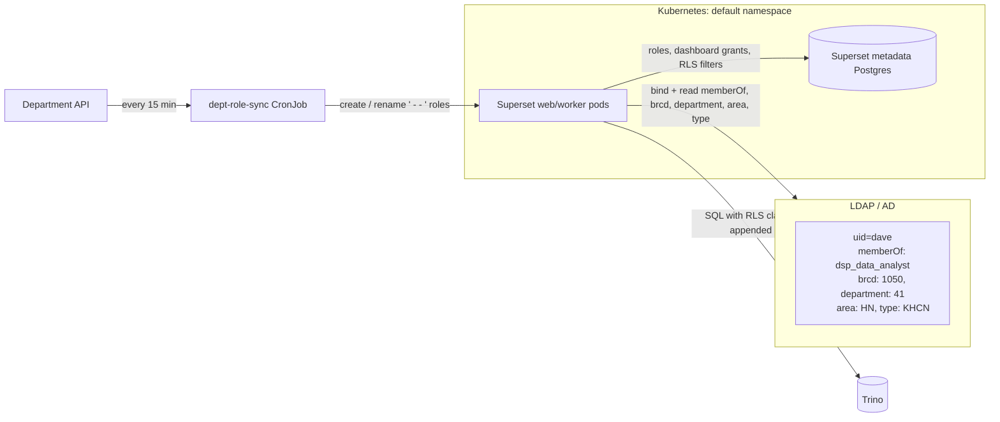

# Superset: LDAP Authentication + Attribute-Based Access

How to run Apache Superset 6.0.0 with LDAP authentication, and how to drive
**what a user can do, which dashboards they can open and which rows they
can see** entirely from information the directory sends at login.

Every user ends up with three kinds of Superset role, all recomputed at
every login:

| Kind | Example | Comes from | Controls |
|---|---|---|---|
| Functional role | `DSP_DATA_ANALYST` | directory group (`memberOf`) | What they can do: view, build charts, SQL Lab, manage |
| Department role | `1050 - 41 - Văn phòng Đoàn Thanh niên` | `brcd` + `department` attributes; role synced from the department API | Which dashboards they can open (`DASHBOARD_RBAC`) |
| Data roles | `AREA_HN`, `RLS_TYPE_KHCN` | `area` and `type` attributes | Which rows they see (RLS: `area IN ('HN') AND CUSTTPCD IN (100, 300, 570)`; on datasets without an `area` column, `brcd IN ('1050') AND CUSTTPCD IN (…)`, the branch taken from the department role). Area and branch are each one per-user Jinja filter |

Every rule, decision and open question is listed in
[ACCESS-RULES.md](ACCESS-RULES.md). The scripts that create the roles and
RLS filters, and the end-to-end test, are in [`data-access/`](data-access/).
The department sync job is in [`dept-role-sync/`](dept-role-sync/).

The same model works behind an OIDC IdP (Keycloak, Okta, Azure AD) instead
of a direct LDAP bind: the attributes become claims. See **Part H**.

## Architecture



At login, `DataAccessSecurityManager` (in the Helm values) turns the
directory entry into roles:

```
memberOf  cn=dsp_data_analyst,...  --AUTH_ROLES_MAPPING-->  DSP_DATA_ANALYST
brcd + department  1050 / 41       --name prefix match-->   "1050 - 41 - <current deptnm>"
area  HN                           --AUTH_ROLES_MAPPING-->  AREA_HN   (Jinja RLS -> area IN ('HN'))
type  KHCN                         --AUTH_ROLES_MAPPING-->  RLS_TYPE_KHCN (RLS CUSTTPCD IN (100, 300, 570))
type  ALL (or all)                 --AUTH_ROLES_MAPPING-->  RLS_TYPE_ALL  (RLS CUSTTPCD IN (KHCN + KHDN codes))
(department role "1050 - …")      --Jinja RLS filter-->     brcd IN ('1050'), only on datasets
                                                            without an area column (no role)
(always)                           --registration role-->   DSP_DATA_VIEWER
```

## Result once set up

Test users in `lldap` (password `Passw0rd!`), the roles they get, and what
they see on the two demo datasets. Both hold the same 6 rows (branches
1050/1070 in HN, 1060 in HCM; `CUSTTPCD` codes 100/300/570 = KHCN,
200/510 = KHDN, and one row with code 999, in neither list);
`demo_branch_detail` has no `area` column, so it's filtered by the user's
branch:

| User | Group → functional role | brcd / dept | area / type | Dashboards | Rows, `demo_branch_data` | Rows, `demo_branch_detail` (no area) |
|---|---|---|---|---|---|---|
| `alice` | `superset_admins` → Admin | – | – | all | all 6, anywhere | all 6 |
| `henry` | `dsp_application_admin` → DSP_APPLICATION_ADMIN | – | – | none (R20 in ACCESS-RULES) | all 6, anywhere; SQL Lab | all 6 |
| `dave` | `dsp_data_analyst` → DSP_DATA_ANALYST | 1050 / 41 | HN / KHCN | Demo - 1050 - 41 | HN ∧ KHCN: 2 rows (1050, 1070) | 1050 ∧ KHCN: 1 row |
| `carol` | (none) → DSP_DATA_VIEWER | 1050 / 41 | HN / KHDN | Demo - 1050 - 41 | HN ∧ KHDN: 1 row | 1050 ∧ KHDN: 1 row |
| `bob` | `dsp_data_steward` → DSP_DATA_STEWARD | 1060 / 41 | HCM / KHDN | Demo - 1060 - 41 | HCM ∧ KHDN: 1 row | 1060 ∧ KHDN: 1 row |
| `erin` | (none) → DSP_DATA_VIEWER | 1050 / 41 | – / – | Demo - 1050 - 41 | 0 rows (deny by default) | 0 rows (no type) |
| `gina` | `dsp_data_analyst` → DSP_DATA_ANALYST | 1050 / 41 | HN / – | Demo - 1050 - 41 | 0 rows (no type) | 0 rows (no type) |
| `ivan` | (none) → DSP_DATA_VIEWER | 1050 / 41 | – / KHCN | Demo - 1050 - 41 | 0 rows (no area) | 1050 ∧ KHCN: 1 row |
| `jack` | (none) → DSP_DATA_VIEWER | 1060 / 41 | HCM / KHCN | Demo - 1060 - 41 | HCM ∧ KHCN: 1 row | 1060 ∧ KHCN: 1 row |
| `kim` | (none) → DSP_DATA_VIEWER | 1050 / 41 | HN / `all` | Demo - 1050 - 41 | HN ∧ (KHCN ∪ KHDN): 3 rows, not code 999 | 1050 ∧ (KHCN ∪ KHDN): 2 rows |

`python3 data-access/demo/test_access.py` checks all of this, including
that non-admins get no data outside their granted dashboards, that viewers
can't create content, that only admins can use SQL Lab, and that the
chart-data cache never serves one user's rows to another: **81/81 checks
pass** (2026-11-18). See [`data-access/README.md`](data-access/README.md).

---

## Part A — Stand up the test LDAP server

[lldap](https://github.com/lldap/lldap) is a minimal LDAP server good enough
for auth testing: it speaks LDAPv3, needs no schema design, and supports
adding arbitrary custom attributes to user entries — which is what lets it
stand in for "our AD sends back a `department`/`employeeType`/custom
extension attribute" without needing a real AD to test against.

```bash
docker run -d --name lldap \
  --restart unless-stopped \
  -p 3890:3890 \
  -p 17170:17170 \
  -e LLDAP_JWT_SECRET="<random secret>" \
  -e LLDAP_LDAP_BASE_DN="dc=example,dc=com" \
  -e LLDAP_LDAP_USER_PASS="adminpass" \
  -v /root/lldap/data:/data \
  lldap/lldap:stable
```

- Port `3890` is the LDAP protocol port — this is what Superset connects to.
- Port `17170` is lldap's own admin web UI / REST+GraphQL API — used below to
  create users and groups, not by Superset.
- `LLDAP_LDAP_USER_PASS` sets the password for the built-in admin account,
  `uid=admin,ou=people,dc=example,dc=com`.

### Create users

lldap has no LDAP-native way to create entries (no `ldapadd` support) —
everything is done through its GraphQL API. Get a JWT first:

```bash
TOKEN=$(curl -s -X POST http://localhost:17170/auth/simple/login \
  -H "Content-Type: application/json" \
  -d '{"username":"admin","password":"adminpass"}' | python3 -c "import json,sys;print(json.load(sys.stdin)['token'])")

gql() { curl -s -X POST http://localhost:17170/api/graphql \
  -H "Authorization: Bearer $TOKEN" -H "Content-Type: application/json" -d "$1"; }
```

```bash
gql '{"query":"mutation{createUser(user:{id:\"alice\",email:\"alice@example.com\",firstName:\"Alice\",lastName:\"Admin\"}){id}}"}'
gql '{"query":"mutation{createUser(user:{id:\"bob\",email:\"bob@example.com\",firstName:\"Bob\",lastName:\"KhcnHN\"}){id}}"}'
gql '{"query":"mutation{createUser(user:{id:\"carol\",email:\"carol@example.com\",firstName:\"Carol\",lastName:\"KhcnHCM\"}){id}}"}'
# ...and the same for dave, erin, gina, henry, ivan, jack (see the "Result" table)
```

Set passwords — the GraphQL API has no password mutation; lldap ships a
dedicated CLI for it (present inside the container at `/app/lldap_set_password`):

```bash
for u in alice bob carol dave erin gina henry ivan jack; do
  docker exec lldap /app/lldap_set_password \
    --base-url "http://localhost:17170" \
    --admin-username admin --admin-password adminpass \
    --username "$u" --password "Passw0rd!"
done
```

### Add the access attributes and groups

Two kinds of directory data feed Superset:

- **Groups** for functional roles. lldap computes `memberOf` on each user
  automatically.
- **Plain attributes on the user entry** for the department and the data
  scope: `brcd`, `department`, `area`, `type`.

```bash
# Register the attributes once (STRING, single-valued).
for a in department brcd area type; do
  gql "{\"query\":\"mutation{addUserAttribute(name:\\\"$a\\\",attributeType:STRING,isList:false,isVisible:true,isEditable:true){ok}}\"}"
done

# Functional-role groups (ids are printed; used by addUserToGroup below).
for g in superset_admins dsp_application_admin dsp_data_steward dsp_data_analyst dsp_data_viewer; do
  gql "{\"query\":\"mutation{createGroup(name:\\\"$g\\\"){id}}\"}"
done

# Per user: attributes...
gql '{"query":"mutation{updateUser(user:{id:\"dave\",insertAttributes:[{name:\"brcd\",value:[\"1050\"]},{name:\"department\",value:[\"41\"]},{name:\"area\",value:[\"HN\"]},{name:\"type\",value:[\"KHCN\"]}]}){ok}}"}'
# ...and groups (groupId from createGroup above)
gql '{"query":"mutation{addUserToGroup(userId:\"dave\",groupId:<dsp_data_analyst id>){ok}}"}'
gql '{"query":"mutation{addUserToGroup(userId:\"admin\",groupId:<superset_admins id>){ok}}"}'
```

The LDAP bind account (`admin`) must be in `superset_admins` too; the
gotcha in Part C explains why. The sync job also logs in as it.

If your AD already has these attributes, under whatever names, skip this
subsection. The attribute names are configurable in
`ACCESS_ATTRIBUTES` (Part C).

### Verify the attributes are actually returned

Check this before touching Superset:

```bash
ldapsearch -x -H ldap://127.0.0.1:3890 \
  -D "uid=admin,ou=people,dc=example,dc=com" -w adminpass \
  -b "dc=example,dc=com" "(uid=dave)" memberOf brcd department area type
```

Expected:

```
dn: uid=dave,ou=people,dc=example,dc=com
memberOf: cn=dsp_data_analyst,ou=groups,dc=example,dc=com
brcd: 1050
department: 41
area: HN
type: KHCN
```

Against a real AD, run the same search as the account Superset binds with:
AD can hide attributes from a given bind account.

---

## Part B — Build a Superset image with LDAP support

The published `apache/superset:6.0.0` image does **not** include
`python-ldap` (or, for that matter, `psycopg2`/`trino` — those happen to
already be present in this deployment's metadata-DB and Trino-dataset use
case, but check your own image if you need them). `python-ldap` is a C
extension with no portable prebuilt wheel, so it needs a compiler and the
OpenLDAP/SASL headers at build time.

**Do not try to install it at pod startup** (e.g. via the Helm chart's
`bootstrapScript`, which runs on every single pod start/restart). It was
tried here first and reliably lost the race against Kubernetes' startup
probe — `apt-get install build-essential` plus compiling `python-ldap` took
5–15 minutes depending on registry/mirror load, which blew past even a
generously raised `failureThreshold`, and every restart repeated the whole
compile from scratch since the container filesystem is ephemeral. Bake it
into the image once instead — see `Dockerfile.superset-ldap` in this repo:

```dockerfile
FROM apache/superset:6.0.0
USER root
RUN apt-get update -qq \
    && apt-get install -y --no-install-recommends libldap2-dev libsasl2-dev build-essential python3-dev \
    && /app/.venv/bin/python -m ensurepip --upgrade \
    && /app/.venv/bin/python -m pip install --no-cache-dir python-ldap trino psycopg2-binary \
    && apt-get purge -y --auto-remove build-essential python3-dev \
    && rm -rf /var/lib/apt/lists/*
USER superset
```

Two non-obvious details baked into that Dockerfile:

- **Use the app's venv pip, not the system `pip`.** The base image's Python
  environment is a virtualenv at `/app/.venv`, and it's on `PATH` ahead of
  the system Python — but a bare `pip install` on this image resolves to
  `/usr/local/bin/pip` (pulled in by the `python3-dev` apt package), which
  installs into the *system* site-packages, invisible to the app. Always
  install with `/app/.venv/bin/python -m pip install ...`.
- **`ensurepip` first.** This image's venv was built with `uv`, which
  doesn't bundle `pip` by default — `/app/.venv/bin/python -m pip` fails
  with `No module named pip` until you run `ensurepip`.

Build and get it into the cluster:

```bash
docker build -f Dockerfile.superset-ldap -t superset-ldap:6.0.0 .

# Verify before deploying anything:
docker run --rm superset-ldap:6.0.0 python3 -c "import ldap, psycopg2, trino; print('OK')"
docker run --rm -e SUPERSET_SECRET_KEY=x superset-ldap:6.0.0 superset version
```

If your kubelet pulls from a registry your cluster can reach, push it there
and point the Helm chart's `image.repository`/`image.tag` at it — the
normal path. If you're on a single-node cluster where the image only needs
to exist on that one node's containerd (as here, on RKE2/k3s), import it
directly into containerd's `k8s.io` namespace instead of pushing anywhere:

```bash
docker save docker.io/library/superset-ldap:6.0.0 -o superset-ldap-6.0.0.tar

ctr -a /run/k3s/containerd/containerd.sock -n k8s.io images import \
  --platform linux/amd64 superset-ldap-6.0.0.tar

# Required: containerd's CRI plugin only "sees" images carrying this label —
# `ctr images import` alone does not set it, so `crictl images` (and hence
# kubelet's ImageStatus check, and hence `imagePullPolicy: IfNotPresent`)
# won't find the image without this.
ctr -a /run/k3s/containerd/containerd.sock -n k8s.io images label \
  docker.io/library/superset-ldap:6.0.0 io.cri-containerd.image=managed
```

Watch out for kubelet's image garbage collector: if the node is under disk
pressure and no running pod references the image yet, kubelet can reclaim it
between the import and the first pod actually starting. If a freshly
imported image disappears from `crictl images` before its pod comes up,
re-import and immediately restart the pod (`kubectl delete pod ...`) so it
gets pinned as "in use" before the next GC pass.

---

## Part C — Configure Superset for LDAP auth

Everything below lives in `configOverrides` in the Helm values (see
[`superset-values.yaml`](superset-values.yaml) for the full file,
including the `DataAccessSecurityManager` class). The chart pastes each
entry into `superset_config.py`.

```python
from flask_appbuilder.security.manager import AUTH_LDAP

AUTH_TYPE = AUTH_LDAP
AUTH_USER_REGISTRATION = True
# Added to every user at every login. Keep it the least-privileged
# functional role: permissions add up across roles.
AUTH_USER_REGISTRATION_ROLE = "DSP_DATA_VIEWER"

AUTH_LDAP_SERVER = "ldap://<ldap-host>:3890"
AUTH_LDAP_SEARCH = "dc=example,dc=com"
AUTH_LDAP_UID_FIELD = "uid"
AUTH_LDAP_BIND_USER = "uid=admin,ou=people,dc=example,dc=com"
AUTH_LDAP_BIND_PASSWORD = "<bind password>"
AUTH_LDAP_FIRSTNAME_FIELD = "givenName"
AUTH_LDAP_LASTNAME_FIELD = "sn"
AUTH_LDAP_EMAIL_FIELD = "mail"

# Functional roles come from groups...
AUTH_LDAP_GROUP_FIELD = "memberOf"
# ...the rest from these user attributes (LDAP attribute names).
ACCESS_ATTRIBUTES = {"brcd": "brcd", "department": "department", "area": "area", "type": "type"}

AUTH_ROLES_MAPPING = {
    # functional roles, keyed by group DN
    "cn=superset_admins,ou=groups,dc=example,dc=com": ["Admin"],
    "cn=dsp_application_admin,ou=groups,dc=example,dc=com": ["DSP_APPLICATION_ADMIN"],
    "cn=dsp_data_steward,ou=groups,dc=example,dc=com": ["DSP_DATA_STEWARD"],
    "cn=dsp_data_analyst,ou=groups,dc=example,dc=com": ["DSP_DATA_ANALYST"],
    "cn=dsp_data_viewer,ou=groups,dc=example,dc=com": ["DSP_DATA_VIEWER"],
    # data roles, keyed "area:<value>" / "type:<value>"
    "area:HN": ["AREA_HN"],
    "area:HCM": ["AREA_HCM"],
    "type:KHCN": ["RLS_TYPE_KHCN"],
    "type:KHDN": ["RLS_TYPE_KHDN"],
    "type:ALL": ["RLS_TYPE_ALL"],   # KHCN + KHDN codes; "all" works too (uppercased)
}
AUTH_ROLES_SYNC_AT_LOGIN = True

CUSTOM_SECURITY_MANAGER = DataAccessSecurityManager   # defined in the values file
FEATURE_FLAGS = {**globals().get("FEATURE_FLAGS", {}), "DASHBOARD_RBAC": True}
```

What `DataAccessSecurityManager` adds to Flask-AppBuilder's standard LDAP
login:

1. **Requests the extra attributes.** FAB's LDAP search only asks for
   name, email and `AUTH_LDAP_GROUP_FIELD`. The class extends that
   search's attribute list with `ACCESS_ATTRIBUTES`.
2. **Turns them into role keys:** `dept:<brcd> - <department>`,
   `area:<area>` and `type:<TYPE>` (uppercased, so `all` = `ALL`). Empty
   attributes give no key.
3. **Resolves the keys** in `get_roles_from_keys`:
   - `area:*` and `type:*` go through `AUTH_ROLES_MAPPING`. An unmapped
     value gives no role, and deny-by-default RLS then hides every row.
   - `dept:*` picks the single role whose name starts with
     `<brcd> - <deptcd> - `. Department role names change when a
     department is renamed, so they can't be mapping keys. If no role
     matches, or several do, the user gets no department role (several
     matches are logged).

`get_roles_from_keys` is also what FAB's OAuth login uses, so the OIDC
variant (Part H) reuses steps 2 and 3 unchanged.

The same values block also sets up the **Jinja RLS filters** for area and
branch (Part F):

- Two macros, registered in `JINJA_CONTEXT_ADDONS`, that build a predicate
  from the current user's roles, or `1 = 0` if there is none. Only values
  matching `[A-Za-z0-9_]` are used.
  - `user_role_filter(column, role_prefix)`: `user_role_filter('area',
    'AREA_')` gives `area IN ('HN')` for a user with `AREA_HN`.
  - `user_brcd_filter(column)`: the `<brcd>` of the user's department
    role(s), e.g. `brcd IN ('1050')`.
- `ENABLE_TEMPLATE_PROCESSING` in `FEATURE_FLAGS`, so RLS clauses are
  rendered. (It also enables Jinja in SQL Lab and virtual-dataset SQL.)
- `DataAccessSecurityManager.get_rls_cache_key`: when any RLS clause is a
  template, appends the user's role names to the chart-data cache key.
  Superset builds that key from the RLS clause text, which is identical
  for every user; without the override one user's cached result is
  served to another (reproduced, see ACCESS-RULES R13b).

> The comment above the macros in the values file deliberately doesn't
> spell out the clauses with double braces: the Superset chart passes
> `configOverrides` through Helm's `tpl`, which fails on
> `function "user_brcd_filter" not defined`.

### Gotcha: `AUTH_ROLES_SYNC_AT_LOGIN` recalculates roles from scratch on
### every login — including for accounts you didn't mean to touch

`AUTH_ROLES_SYNC_AT_LOGIN = True` means the user's role set is
**replaced**, not merged, at every login, with whatever the directory
yields, plus `AUTH_USER_REGISTRATION_ROLE`. This bit us directly: the LDAP
bind account (`uid=admin`) had no mapped value at first. The first time it
logged into Superset through LDAP, its existing `Admin` role was silently
replaced by the default role.

Consequences:

- Every account that needs a non-default role, including bind and service
  accounts such as the one `dept-role-sync` logs in as, must get it from
  the directory. Here, `admin` is in `superset_admins`.
- Roles assigned by hand in the Superset UI are lost at that user's next
  login.

If you hit this after the fact, restore the role directly:

```sql
insert into ab_user_role (id, user_id, role_id)
values (nextval('ab_user_role_id_seq'), <user_id>, <admin_role_id>);
```

### Also required: `python-ldap`/`trino`/`psycopg2` need libc/OS packages

Already covered by the image in Part B. `AUTH_TYPE = AUTH_LDAP` does nothing
useful without `python-ldap` importable in the running container, and
there's no clear in-app error when it's missing: it surfaces as
`ModuleNotFoundError: No module named 'ldap'` deep in a gunicorn worker
traceback at startup.

---

## Part D — Deploy

```bash
helm upgrade --install superset superset/superset \
  -f superset-values.yaml -n default
```

Key values to set alongside the LDAP `configOverrides` above (see the full
file in this repo):

```yaml
image:
  repository: docker.io/library/superset-ldap   # the image from Part B
  tag: "6.0.0"
  pullPolicy: IfNotPresent

extraSecretEnv:
  SUPERSET_SECRET_KEY: "<random secret>"         # Superset refuses to start on the default
```

If you're changing an **existing** release's chart version, be aware that a
newer chart can change the Deployment's `spec.selector.matchLabels` (this
happened going from an old pinned `superset-0.15.5` install to whatever the
repo currently serves) — that field is immutable on a Kubernetes
Deployment, so `helm upgrade` fails outright with a `field is immutable`
error. The fix is `helm uninstall` + fresh `helm install`, not an upgrade.
This is safe for the Postgres metadata store specifically because
StatefulSet-managed PVCs (`data-superset-postgresql-0`, created from the
chart's `volumeClaimTemplate`) are **not** deleted by `helm uninstall` —
only by deleting the PVC object directly, which uninstall doesn't do. A
fresh install with the same release name and same `postgresql.auth`
credentials reattaches to the existing PVC and keeps every user, role, and
dataset that was already there.

---

## Part E — Create the roles

Flask-AppBuilder **does not create** roles named in `AUTH_ROLES_MAPPING`.
A missing role is silently dropped from the user's roles at login:

```
WARNING:flask_appbuilder.security.manager:Can't find role specified in AUTH_ROLES_MAPPING: AREA_HN
```

So all three kinds of role must exist before users log in:

| Roles | Created by |
|---|---|
| `DSP_*` functional roles | Imported once from a roles export: `superset fab import-roles --path dsp_roles.json` (run in a Superset pod; [`data-access/roles/dsp_roles.json`](data-access/roles/dsp_roles.json)) |
| `<brcd> - <deptcd> - <deptnm>` department roles | The [`dept-role-sync`](dept-role-sync/README.md) CronJob, every 15 minutes |
| `AREA_*`, `RLS_TYPE_*` data roles | [`data-access/setup_rls.py`](data-access/README.md), together with their RLS filters (Part F) |

Department and data roles carry **no permissions**. Users still get data,
because:

- **dashboards** are granted to department roles (`DASHBOARD_RBAC`), and a
  user can read the chart data of a published dashboard granted to them,
  without dataset permissions;
- **data roles** only exist to select RLS filters.

`DSP_APPLICATION_ADMIN` and `Admin` have `all_datasource_access` instead.

---

## Part F — Set up Row Level Security

[`data-access/setup_rls.py`](data-access/setup_rls.py) creates everything
from [`rls_config.json`](data-access/rls_config.json) and is idempotent.
Re-run it after adding an area or type value, or a dataset.

```bash
cd data-access
SUPERSET_URL=http://superset.default.svc.cluster.local:8088 \
SUPERSET_USERNAME=admin SUPERSET_PASSWORD=... python3 setup_rls.py
```

The script never deletes. If an earlier version created the per-value
area filters (`RLS area = HN`, `RLS area = HCM`, `RLS area: deny by
default`), delete them in *Settings → Row Level Security*: left in place,
their `area = 'HN'` would be ORed into the Jinja filter's group.

Resulting filters, attached automatically to **every dataset that has the
filtered column**, except that the branch filter skips datasets that also
have an `area` column (there, `area` already scopes the rows, and a branch
filter would narrow "my area" to "my branch"):

| Filter | Type | Roles | Group key | Clause |
|---|---|---|---|---|
| `RLS area: per user` | **Base** | excludes `Admin`, `DSP_APPLICATION_ADMIN` | `area` | `{{ user_role_filter('area', 'AREA_') }}` |
| `RLS type = KHCN` | Regular | `RLS_TYPE_KHCN` | `custtpcd` | `CUSTTPCD IN (100, 300, 570)` |
| `RLS type = KHDN` | Regular | `RLS_TYPE_KHDN` | `custtpcd` | `CUSTTPCD IN (200, 510, 520, 530, 540, 550, 560, 600, 700, 800)` |
| `RLS type = ALL` | Regular | `RLS_TYPE_ALL` | `custtpcd` | `CUSTTPCD IN (<union of the two lists>)` |
| `RLS type: deny by default` | **Base** | excludes `Admin`, `DSP_APPLICATION_ADMIN` | `custtpcd` | `1 = 0` |
| `RLS brcd: per user` | **Base** | excludes `Admin`, `DSP_APPLICATION_ADMIN` | `brcd` | `{{ user_brcd_filter('brcd') }}` |

The two `per user` filters are Jinja templates that Superset renders per
user: the area filter to `area IN ('<the user's AREA_* suffix>')`, the
branch filter to `brcd IN ('<the user's brcd>')`, each `1 = 0` if the user
has no value. One branch filter covers all ~1000 branches: there are no
branch roles, and a new branch needs no setup. In *Settings → Row Level
Security* you see the template; the rendered clause shows up in a chart's
*View query* when logged in as a filtered user (not as an admin, who is
excluded).

How Superset combines them:

- A **Regular** filter applies to users who **have** one of its roles. A
  **Base** filter applies to everyone **except** its roles.
- Filters with the **same group key are ORed**; different group keys are
  ANDed.

The type code lists are in `rls_config.json`; `setup_rls.py` builds the
`ALL` clause as their union, so a code in neither list stays hidden even
from `RLS_TYPE_ALL`.

So for dave (`AREA_HN`, `RLS_TYPE_KHCN`) the query gets
`(area IN ('HN')) AND (1 = 0 OR CUSTTPCD IN (100, 300, 570))`. A user missing
either attribute gets `1 = 0` for that group, which means no rows. Admins
skip the Base filters and have no Regular ones, so they see everything. On
a dataset without `area`, dave gets `(brcd IN ('1050')) AND (1 = 0 OR
CUSTTPCD IN (100, 300, 570))` instead.

Why deny by default: Regular filters only restrict users who hold their
roles, so without the `type` Base filter a user with no `type` attribute
would see **every** type. The Jinja filters are Base filters that render
`1 = 0` themselves.

RLS does **not** apply to SQL Lab unless `RLS_IN_SQLLAB` is enabled (off by
default). In this setup only `Admin` and `DSP_APPLICATION_ADMIN` have SQL
Lab, and both are unrestricted anyway.

---

## Part G — Test it end-to-end

```bash
cd data-access
export SUPERSET_URL=http://<superset> SUPERSET_USERNAME=admin SUPERSET_PASSWORD=...
python3 demo/setup_demo.py    # 2 datasets, 3 charts, 2 dashboards
python3 setup_rls.py
python3 demo/test_access.py   # logs in as each test user via LDAP
```

`setup_demo.py` builds two virtual datasets over Trino (`VALUES`, no table
to load): `demo_branch_data` with an `area` column and `demo_branch_detail`
without one. Two published dashboards show charts from both:

- `Demo - 1050 - 41`, granted to role `1050 - 41 - …`
- `Demo - 1060 - 41`, granted to role `1060 - 41 - …`

`test_access.py` checks, for every user in the "Result" table above:

- their roles after login;
- which demo dashboards they can list;
- the rows returned from each dataset through each dashboard, through a dashboard they
  weren't granted (must be denied), and with no dashboard context (must be
  denied except for admins);
- whether they can create content;
- whether they can use SQL Lab;
- that the Jinja filters render `area IN ('HN')` and `brcd IN ('1050')`
  for dave (and no `area IN` for ivan, who has no area), and that after
  dave fills the cache, `jack` (1060/HCM, the same RLS filters otherwise)
  gets a different cache key and only his own rows, on both datasets.

```
PASS  dave   roles
PASS  dave   dashboards visible ['Demo - 1050 - 41']
PASS  dave   data   via 'Demo - 1050 - 41': 2 rows
PASS  dave   data   via 'Demo - 1060 - 41': denied
PASS  dave   data   without dashboard: denied
PASS  dave   detail via 'Demo - 1050 - 41': 1 rows
PASS  dave   detail without dashboard: denied
PASS  dave   create content: True
PASS  dave   SQL Lab: False
...
PASS  dave   area dataset SQL has area IN ('HN'), no brcd
PASS  dave   area-less dataset SQL has brcd IN ('1050'), no area
PASS  ivan   no AREA_* role: no area IN (...) in SQL
PASS  cache  data: dave and jack get different cache keys
PASS  cache  data: jack is not served dave's cached rows
PASS  cache  data: caching is on (jack's repeat is a cache hit)
PASS  cache  detail: dave and jack get different cache keys
...
81/81 checks passed
```

---

## Part H — Variant: authorization from OIDC claims, not LDAP at all

Everything above assumes Superset talks to LDAP directly. Plenty of real
deployments don't: Superset sits behind an OIDC identity provider
(Keycloak, Okta, Azure AD / Entra ID, Auth0, ...) that itself may be backed
by the same AD/LDAP directory — the IdP's admin configures a "protocol
mapper" / "claim mapper" that copies an AD attribute (or a group name, or
anything else the IdP can compute) into a custom claim on the ID token or
userinfo response. Superset never talks to LDAP in this setup; it only
ever sees the OIDC claims.

**The good news: the mechanism is identical, just relocated.** FAB's OAuth
login path supports the exact same `role_keys` → `AUTH_ROLES_MAPPING` →
role → RLS pipeline as the LDAP path — it just gets `role_keys` from a
different place: a custom Security Manager method
(`get_oauth_user_info`) that you write, instead of a built-in
`AUTH_LDAP_GROUP_FIELD` setting. Confirmed by reading
`flask_appbuilder/security/manager.py` directly (not guessed): line 1365
of the installed FAB version does
`user_role_keys = userinfo.get("role_keys", [])` in the OAuth login path,
feeding the identical `get_roles_from_keys()` the LDAP path uses at line
1067. Nothing about `AUTH_ROLES_MAPPING`, role creation (Part E), or RLS
(Part F) changes — only Part A (identity source) and Part C (auth config)
do.

### Stand up a lightweight test OIDC provider

[mock-oauth2-server](https://github.com/navikt/mock-oauth2-server) is the
OIDC analogue of `lldap` here: a single-JAR test IdP purpose-built for
exactly this — issuing tokens with whatever custom claims you want, with
no real login UI required for automation.

```bash
docker run -d --name mock-oidc --restart unless-stopped \
  -p 8090:8080 \
  ghcr.io/navikt/mock-oauth2-server:latest
```

Its discovery document is **request-relative** — it reflects whatever
host:port you actually used to reach it, not a fixed hostname. That
matters because Superset's pod reaches this container through the node's
own IP (the same pattern as `AUTH_LDAP_SERVER` above), not `localhost`:

```bash
curl -s http://<node-ip>:8090/default/.well-known/openid-configuration | python3 -m json.tool
# issuer / authorization_endpoint / etc. all come back as <node-ip>:8090,
# exactly the host actually used for the request
```

### Configure Superset for OIDC

Needs `authlib` (Superset's OAuth stack), which — like `python-ldap` in
Part B — is **not** in the base `apache/superset:6.0.0` image. Unlike
`python-ldap`, it's a pure-Python wheel with no compiler needed, so
installing it via `bootstrapScript` at pod startup is fine (it won't race
the startup probe the way a `python-ldap` compile did):

```yaml
bootstrapScript: |
  #!/bin/bash
  if [ ! -f ~/bootstrap ]; then
    /app/.venv/bin/python -m pip install --no-cache-dir Authlib
    echo "Running Superset bootstrap" > ~/bootstrap
  fi
```

```python
from flask_appbuilder.security.manager import AUTH_OAUTH
from superset.security import SupersetSecurityManager

AUTH_TYPE = AUTH_OAUTH
AUTH_USER_REGISTRATION = True
AUTH_USER_REGISTRATION_ROLE = "DSP_DATA_VIEWER"
AUTH_ROLES_SYNC_AT_LOGIN = True

# Same mapping as Part C, except functional roles are keyed by whatever
# the IdP puts in its "groups" claim (names here, not LDAP DNs).
AUTH_ROLES_MAPPING = {
    "superset_admins": ["Admin"],
    "dsp_application_admin": ["DSP_APPLICATION_ADMIN"],
    "dsp_data_steward": ["DSP_DATA_STEWARD"],
    "dsp_data_analyst": ["DSP_DATA_ANALYST"],
    "dsp_data_viewer": ["DSP_DATA_VIEWER"],
    "area:HN": ["AREA_HN"], "area:HCM": ["AREA_HCM"],
    "type:KHCN": ["RLS_TYPE_KHCN"], "type:KHDN": ["RLS_TYPE_KHDN"], "type:ALL": ["RLS_TYPE_ALL"],
}

OAUTH_PROVIDERS = [
    {
        "name": "oidc",
        "icon": "fa-key",
        "token_key": "access_token",
        "remote_app": {
            "client_id": "superset",
            "client_secret": "supersetsecret",
            "api_base_url": "http://<node-ip>:8090/default/",
            "server_metadata_url": "http://<node-ip>:8090/default/.well-known/openid-configuration",
            "client_kwargs": {"scope": "openid email profile"},
        },
    }
]

# Subclass the LDAP setup's manager: its get_roles_from_keys (static
# mapping + "<brcd> - <deptcd> - " prefix lookup) and access_role_keys are
# reused as-is. Only where the values come from changes: claims instead of
# LDAP attributes.
class OidcDataAccessSecurityManager(DataAccessSecurityManager):
    def get_oauth_user_info(self, provider, resp):
        if provider != "oidc":
            return {}
        me = self.appbuilder.sm.oauth_remotes[provider].get("userinfo")
        me.raise_for_status()
        data = me.json()
        name = data.get("name") or ""
        return {
            "username": data.get("sub"),
            "email": data.get("email"),
            "first_name": name.split(" ")[0] if name else "",
            "last_name": " ".join(name.split(" ")[1:]) if name else "",
            "role_keys": list(data.get("groups") or []) + self.access_role_keys(
                data.get("brcd"), data.get("department"), data.get("area"), data.get("type")
            ),
        }

CUSTOM_SECURITY_MANAGER = OidcDataAccessSecurityManager
```

`api_base_url` is what `.get("userinfo")` resolves against — it must match
the provider's actual `userinfo_endpoint`. `server_metadata_url` lets
authlib auto-discover `authorize_url`/`access_token_url`/`jwks_uri` instead
of hardcoding each one.

**Note:** `AUTH_TYPE` is a single value — a Superset instance is LDAP *or*
OAuth, not both at once through this mechanism. Swapping to this config
replaces the LDAP login entirely; it's not additive.

### Test it — no real browser needed

mock-oauth2-server's "login page" is a plain HTML form (`username` +
`claims` fields) that POSTs back to the same URL — which means the whole
authorization-code flow is scriptable with a cookie jar, the same way the
LDAP tests in Part G were:

```bash
COOKIES=cookies.txt

# 1. Ask Superset to start an OIDC login -- it redirects to the IdP with a
#    state/nonce it will later verify, and sets a session cookie to track them.
LOGIN_REDIRECT=$(curl -s -c $COOKIES -o /dev/null -D - http://localhost:8088/login/oidc \
  | grep -i '^Location:' | sed 's/Location: //I' | tr -d '\r')

# 2. Instead of a real login page, POST straight to that authorize URL
#    with the username and the custom claims this "user" should carry.
CALLBACK=$(curl -s -X POST "$LOGIN_REDIRECT" \
  --data-urlencode "username=bob" \
  --data-urlencode 'claims={"department":"HN","email":"bob@example.com","name":"Bob KhcnHN"}' \
  -D - -o /dev/null | grep -i '^location:' | sed 's/[Ll]ocation: //' | tr -d '\r')

# 3. Follow the IdP's redirect back into Superset's own callback, same
#    cookie jar so it can validate the state/nonce it stashed in step 1.
curl -s -c $COOKIES -b $COOKIES "$CALLBACK" -o /dev/null -D -   # -> 302 to "/" means success

# 4. From here it's a normal authenticated session -- same cookie jar,
#    same CSRF-token dance as Part G.
curl -s -c $COOKIES -b $COOKIES http://localhost:8088/api/v1/me/
```

> **Test status:** the OIDC flow below was verified with the earlier,
> single-claim mapping (`department: HN` → `KHCN`, `Region_HN`). The
> multi-claim config above reuses the LDAP-tested `get_roles_from_keys`
> unchanged, but hasn't been re-run against an IdP. To test it, send
> `brcd`/`department`/`area`/`type`/`groups` in the step-2 `claims` and
> run `data-access/demo/test_access.py`-style checks.

Verified end to end exactly this way: step 4's `/api/v1/me/` confirms
Superset logged in `bob` (`sub: bob` from the claims in step 2, matched to
username), and the metadata DB shows the same role sync as the LDAP path:

```
 bob | Gamma
 bob | KHCN
 bob | Region_HN
```

...and the Chart Data API against the same RLS-protected dataset from Part
F, using this session's cookie jar instead of a JWT, returns the same
single row set as the LDAP version — `region_name = 'ASIA'` only. Nothing
downstream of "which roles does this user have" needed to change at all.

---

## Part I — Department roles synced from an API

Department roles come from an external department API and are used to
grant dashboards. See [`dept-role-sync/`](dept-role-sync/README.md): a
Helm-deployed CronJob (own image, TLS and Vault options) that creates
`"<brcd> - <deptcd> - <deptnm>"` roles and renames them in place when
`deptnm` changes. At login, `DataAccessSecurityManager` (Part C) gives the
user the role matching their `brcd` + `department` attributes by that
prefix.

---

## Troubleshooting

**`ModuleNotFoundError: No module named 'ldap'` at Superset startup** — the
image doesn't have `python-ldap` installed into the venv Superset actually
runs under. See Part B; check with
`docker run --rm <image> python3 -c "import ldap"` before deploying.

**`ModuleNotFoundError: No module named 'authlib'` at Superset startup**
(OIDC variant, Part H) — same class of problem, different package: the
base image doesn't bundle `authlib` either, and `AUTH_TYPE = AUTH_OAUTH`
imports it unconditionally during app init, before any of your own config
code runs, so there's no way to defer it. Unlike `python-ldap` this one has
no C extension, so — uniquely among the packages in this repo — it's fine
to install it via `bootstrapScript` at pod startup rather than baking it
into the image; see Part H.

**Pod stuck restarting during a heavy `bootstrapScript`, startup probe
failing with `connection refused`** — the probe is timing out before a
runtime `apt-get install` + compile finishes, and every restart repeats it
from zero. Don't install compiled dependencies at pod startup; bake them
into the image (Part B).

**`Can't find role specified in AUTH_ROLES_MAPPING: <name>`** in the logs —
the role doesn't exist yet in Superset's RBAC. Create it (Part E); FAB does
not auto-create mapped roles.

**A previously-Admin account gets silently downgraded to `Gamma` after
logging in via LDAP once** — `AUTH_ROLES_SYNC_AT_LOGIN` replaced its role
set because that account's `AUTH_LDAP_GROUP_FIELD` value (a group, an
attribute, whichever you configured) wasn't in `AUTH_ROLES_MAPPING` — often
because the attribute was simply blank/unset on that particular entry. Set
the attribute (or group membership) on every real account that needs a
non-default role, not just the "interesting" ones — see the gotcha in
Part C.

**A user sees a granted dashboard, but every chart is empty** — RLS
deny by default (Part F): the user is missing the `area` or `type`
attribute, or has a value with no `AREA_*`/`RLS_TYPE_*` mapping. On datasets
without `area`, the user has no department role (the branch filter
renders `1 = 0`), or `ENABLE_TEMPLATE_PROCESSING` is off (the clause isn't
rendered, and the query fails). Check their
roles in *Settings → List Users*. The fix belongs in the directory, not in
Superset (roles are rebuilt at every login).

**A dashboard granted to a department role doesn't appear for its users**
— with `DASHBOARD_RBAC`, a role-granted dashboard must be **published**. A
draft is visible only to Admins and its owners. Also check that the user
has that exact `<brcd> - <deptcd> - ` role: both attributes must match the
API's codes exactly, leading zeros included.

**`DATASOURCE_SECURITY_ACCESS_ERROR` when a user with the "right" RLS role
still can't query the dataset** — RLS restricts *rows*, it doesn't grant
*access*. The role also needs `datasource_access` (and `database_access`)
permission-views attached, same as any other Superset role. Grant this
through the role editor UI, or by inserting into
`ab_permission_view_role` (see below) if scripting it.

**`duplicate key value violates unique constraint "..._pkey"` on a table
you just inserted into by hand** — if you ever insert into a FAB-managed
table (`ab_user_role`, `ab_permission_view_role`, etc.) with a manually
computed `id` (e.g. `max(id)+1`) instead of the table's sequence, the
sequence itself doesn't advance, and the next row the *application* inserts
via `nextval()` collides with the id you already used. Always insert with
`nextval('<table>_id_seq')` explicitly, never a hand-computed id:

```sql
insert into ab_permission_view_role (id, permission_view_id, role_id)
values (nextval('ab_permission_view_role_id_seq'), <perm_view_id>, <role_id>);
```

If you've already caused a collision, resync the sequence to the table's
actual max before the app tries to insert again:

```sql
select setval('ab_permission_view_role_id_seq', (select max(id) from ab_permission_view_role));
```

**`{"message":{"provider":["Alternative authentication provider is not
allowed"]}}`** on `/api/v1/security/login` — you passed `"provider":"db"`
while `AUTH_TYPE = AUTH_LDAP` is set globally; the app only accepts
`"provider":"ldap"` (or omit `provider`) once LDAP is the configured auth
type. Any pre-existing local Superset user can still be reached this way if
their **username** matches an LDAP entry — logging in as `admin`/LDAP
authenticates against the LDAP directory, then reuses/updates Superset's
existing local `admin` row by username.

**A POST to `/api/v1/security/roles/` or `/api/v1/dataset/` returns `"The
CSRF session token is missing"` even with a valid `X-CSRFToken` header** —
fetch the CSRF token and make the follow-up request through the *same
cookie jar* (`curl -c cookies.txt -b cookies.txt ...` for both calls). The
CSRF token is paired with a session cookie set by the
`/api/v1/security/csrf_token/` call; sending only the JWT and the header
without that cookie fails validation on some endpoints.

**Kubelet reports `DiskPressure` and evicts pods (including, confusingly,
unrelated ones like `postgresql`/`redis`) while building a large custom
image on the same node** — image builds and `docker save`/`ctr import`
tarballs can transiently consume tens of GB. If the node crosses kubelet's
`imagefs`/`nodefs` high-watermark (commonly ~85%), it starts garbage
collecting *and* evicting, and can reclaim images you just imported before
any pod uses them (see Part B). Prune build cache (`docker builder prune
-af`) between builds, and clean up stale `Evicted`/`ContainerStatusUnknown`
pods across the cluster (`kubectl delete pods --field-selector
status.phase=Failed`) to let kubelet reclaim their leftover container
state — this is often enough to bring usage back under the threshold
without touching other projects' images.
