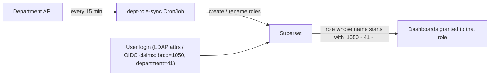

# Department role sync

Keeps Superset roles in step with a department API, so dashboards can be
granted per department.

Each department `{"brcd": 1050, "deptcd": "41", "deptnm": "Văn phòng Đoàn
Thanh niên"}` becomes a Superset role named
`1050 - 41 - Văn phòng Đoàn Thanh niên`, i.e. `<brcd> - <deptcd> - <deptnm>`.
The same `deptcd` in another branch is a different role
(`1060 - 41 - ...`). When `deptnm` changes upstream, the existing role is
**renamed in place**: same role id, so user assignments and dashboard
grants survive the rename. Departments that disappear from the API are left
alone (no deletes).

**API contract:**

```json
{"success": true,
 "data": {"departments": [{"brcd": 1050, "deptcd": "41", "deptnm": "..."}, ...]}}
```

- `brcd` is read from each department. If it's missing, the response-level
  `data.brcd` is used.
- Codes are treated as strings, so leading zeros are kept.
- A department without `brcd` or `deptcd` is skipped with an error.

This is one of three role sources; see
[../ACCESS-RULES.md](../ACCESS-RULES.md) for the whole access model.

## How it fits together



Three pieces:

1. **The sync job** — `sync_roles.py`, packaged by `Dockerfile` and
   deployed as a CronJob by the Helm chart in `chart/dept-role-sync/`. It
   fetches departments, lists Superset roles, matches them to departments
   by the `"<brcd> - <deptcd> - "` name prefix, then creates missing roles
   and renames changed ones. Stdlib only, idempotent.
2. **A custom security manager** in Superset's config (see
   `../superset-values.yaml`, `DataAccessSecurityManager`). At login, a
   user whose `brcd` is `1050` and `department` is `41` gets whichever role
   *currently* starts with `1050 - 41 - `. The static
   `AUTH_ROLES_MAPPING` can't do this, because it's keyed by exact role
   name and the name changes on rename. `get_roles_from_keys` is shared
   by Flask-AppBuilder's LDAP and OAuth login paths, so this works the
   same for an OIDC claim.
3. **`DASHBOARD_RBAC` feature flag** — lets an admin grant a dashboard to
   roles (dashboard *Properties → Roles*). No other permissions need to be
   configured on the department roles.

```
dept-role-sync/
├── sync_roles.py              the job
├── Dockerfile                 job image (python:3.12-alpine, non-root uid 10001)
├── chart/
│   ├── dept-role-sync/        Helm chart (CronJob, ServiceAccount, optional Secret)
│   └── examples/
│       ├── values-mock.yaml        this test cluster
│       └── values-production.yaml  registry image, HTTPS + CA, Vault, proxy
└── mock-api/                  fake department API for testing
```

## Build the image

```bash
docker build -t registry.example.com/data/dept-role-sync:0.2.0 dept-role-sync/
docker push registry.example.com/data/dept-role-sync:0.2.0
```

The image runs as uid 10001 with a read-only root filesystem (the chart
sets this). Its entrypoint is the script, so `docker run <image> --dry-run`
works for a one-off preview.

> **No registry (this single-node test cluster):** the image was built
> locally and imported into RKE2's containerd, like `superset-ldap`:
> ```bash
> docker save dept-role-sync:0.2.0 -o /tmp/drs.tar
> ctr -a /run/k3s/containerd/containerd.sock -n k8s.io images import --platform linux/amd64 /tmp/drs.tar
> ctr -a /run/k3s/containerd/containerd.sock -n k8s.io images label docker.io/library/dept-role-sync:0.2.0 io.cri-containerd.image=managed
> ```
> Disk-pressure image GC can evict it the same way; re-run the above if
> jobs start failing with `ErrImagePull`.

## Deploy with Helm

```bash
# test cluster (mock API, chart-created Secret)
helm upgrade --install dept-role-sync chart/dept-role-sync -n default \
  -f chart/examples/values-mock.yaml --set credentials.supersetPassword='...'

# production-shaped (see the file; credentials come from Vault)
helm upgrade --install dept-role-sync chart/dept-role-sync -n superset \
  -f chart/examples/values-production.yaml

# run once now instead of waiting for the schedule
kubectl create job dept-role-sync-manual -n default --from=cronjob/dept-role-sync
kubectl logs -n default job/dept-role-sync-manual
```

The Superset account must be able to create and edit roles. In practice
that means an Admin: a DB user (`superset.authProvider: db`) or an LDAP
user mapped to Admin (`ldap`).

### Configuration

Endpoints and behaviour are passed to the job as environment variables.
The chart sets them from values; for a local run, set them yourself.

| Helm value | Env var | Default | |
|---|---|---|---|
| `deptApi.url` | `DEPT_API_URL` | — (required) | Department API endpoint |
| `deptApi.authHeader` | `DEPT_API_AUTH_HEADER` | `Authorization` | Header carrying the token |
| `deptApi.authScheme` | `DEPT_API_AUTH_SCHEME` | `Bearer` | `""` sends the bare token (e.g. `X-API-Key`) |
| `deptApi.tls.insecureSkipVerify` | `DEPT_API_INSECURE_SKIP_VERIFY` | `false` | Skip TLS verification |
| `deptApi.tls.caBundle.*` | `DEPT_API_CA_BUNDLE` | — | Trust a CA, see below |
| `superset.url` | `SUPERSET_URL` | — (required) | Superset base URL |
| `superset.authProvider` | `SUPERSET_AUTH_PROVIDER` | `ldap` | `db` or `ldap` |
| `superset.tls.insecureSkipVerify` | `SUPERSET_INSECURE_SKIP_VERIFY` | `false` | Skip TLS verification |
| `superset.tls.caBundle.*` | `SUPERSET_CA_BUNDLE` | — | Trust a CA, see below |
| `dryRun` | `DRY_RUN` | `false` | Log changes, make none |
| `logLevel` | `LOG_LEVEL` | `INFO` | |
| `httpTimeout` | `HTTP_TIMEOUT` | `30` | Seconds, per request |
| credentials (below) | `DEPT_API_TOKEN`, `SUPERSET_USERNAME`, `SUPERSET_PASSWORD` | | |
| `vault.enabled` | `SECRETS_FILES` | — | JSON file(s) of credentials, loaded at start |

Other chart values: `image.*`, `imagePullSecrets`, `schedule`, `timeZone`,
`suspend`, `concurrencyPolicy` (default `Forbid`),
`startingDeadlineSeconds`, history limits, `backoffLimit`,
`activeDeadlineSeconds`, `ttlSecondsAfterFinished`, `serviceAccount.*`,
`extraEnv` / `extraEnvFrom` (e.g. `HTTPS_PROXY`, `NO_PROXY`, which the job
honours), `extraVolumes` / `extraVolumeMounts`, `hostAliases`,
`podAnnotations` / `podLabels`, security contexts, `resources`,
`nodeSelector`, `tolerations`, `affinity`. Everything is listed in
`chart/dept-role-sync/values.yaml`.

### TLS

Each endpoint has its own settings, so e.g. the department API can use a
corporate CA while Superset is reached over plain in-cluster HTTP.

- **Trust a private CA** (preferred): put the PEM in a ConfigMap or Secret
  in the release namespace and point the chart at it. The chart mounts it
  and sets `*_CA_BUNDLE`. That CA replaces the system trust store for that
  endpoint, so include intermediates or a full bundle if needed.
  ```yaml
  deptApi:
    tls:
      caBundle:
        configMap: corporate-ca   # or  secret: corporate-ca
        key: ca.crt               # key inside it
  ```
- **Skip verification** (`tls.insecureSkipVerify: true`): accepts any
  certificate and logs a warning on every run. For testing, or a
  self-signed endpoint you can't get a CA for. It takes precedence over
  `caBundle`.

### Credentials

Pick one source:

1. **`existingSecret: <name>`** — a Secret you manage, with keys
   `DEPT_API_TOKEN` (optional), `SUPERSET_USERNAME`, `SUPERSET_PASSWORD`.
2. **`credentials.*`** — the chart creates that Secret from values. Fine
   for testing; avoid committing the password in a values file.
3. **`vault.enabled: true`** — HashiCorp Vault Agent Injector. The chart
   creates no Secret.

#### Vault

Requires the Vault Agent Injector in the cluster and Vault's Kubernetes
auth method. The chart adds injector annotations to the job pod:

- `agent-pre-populate-only: "true"` — an init container fetches the
  secret and exits. Without this, the agent sidecar keeps running and the
  Job never completes.
- The secret at `vault.secretPath` is rendered as JSON to
  `/vault/secrets/credentials.json`, and the job loads it through
  `SECRETS_FILES`. JSON keeps passwords with any characters intact. Every
  key of the Vault secret becomes an env var, so name them exactly
  `DEPT_API_TOKEN`, `SUPERSET_USERNAME`, `SUPERSET_PASSWORD`.

One-time Vault setup (KV v2 at `secret/`; the service account is named
after the release, `dept-role-sync` here):

```bash
vault kv put secret/superset/dept-role-sync \
  DEPT_API_TOKEN=... SUPERSET_USERNAME=admin SUPERSET_PASSWORD=...

vault policy write dept-role-sync - <<'EOF'
path "secret/data/superset/dept-role-sync" { capabilities = ["read"] }
EOF

vault write auth/kubernetes/role/dept-role-sync \
  bound_service_account_names=dept-role-sync \
  bound_service_account_namespaces=superset \
  policies=dept-role-sync ttl=15m
```

| Value | |
|---|---|
| `vault.role` | Kubernetes-auth role name |
| `vault.secretPath` | Secret path. For KV v2, include `/data/` (`secret/data/...`) |
| `vault.kvVersion` | `2` (default) or `1`; picks `.Data.data` vs `.Data` |
| `vault.authPath` | Non-default auth mount, e.g. `auth/k8s-prod` |
| `vault.namespace` | Vault Enterprise namespace |
| `vault.address` | Override the injector's default Vault address |
| `vault.tlsSkipVerify` | Agent → Vault without TLS verification |
| `vault.caCertSecret` / `vault.caCertPath` | Vault CA for the agent |
| `vault.annotations` | Any other `vault.hashicorp.com/*` annotation |

## Mock API (for testing)

`mock-api/server.py` serves `mock-api/departments.json` at
`GET /api/departments` (Bearer token required). It re-reads the file on
every request, so editing a `deptnm` there simulates an upstream rename.
The data is the provided branch 1050 export (84 departments) plus three
branch-1060 departments that reuse codes `41`, `06` and `07`. Those test
that the same `deptcd` in two branches gives two roles.
Set `TLS_CERT`/`TLS_KEY` to serve HTTPS instead.

```bash
docker run -d --name dept-api --restart unless-stopped -p 8091:8000 \
  -e API_TOKEN=dept-api-test-token \
  -v "$PWD/mock-api":/data:ro -e DATA_FILE=/data/departments.json \
  python:3.12-alpine python /data/server.py
```

## Verified end to end

On the test cluster (2026-11-17), with the `<brcd> - <deptcd> - <deptnm>`
format (job 0.2.0):

- First sync against the 87-department mock data: `created: 87`, including
  `1050 - 41 - ...` and `1060 - 41 - ...` as separate roles. A re-run
  gives `unchanged: 87`.
- Renamed `1050 / 41` in the mock JSON and re-synced: `renamed: 1,
  unchanged: 86`. Role id 134 kept its id; only its name changed. LDAP
  user `dave` (`brcd 1050`, `department 41`) logged in again, got role 134
  under its new name, and still saw the dashboard granted to it. Renamed
  back afterwards.
- Dashboard grants and data: `bob` (`brcd 1060`, `department 41`) sees only
  the dashboard granted to `1060 - 41 - ...` and is denied data through
  the `1050 - 41` dashboard. This is part of the full access test,
  `../data-access/demo/test_access.py` (81/81 checks pass).

Job 0.1.0 (`<deptcd> - <deptnm>` format) was verified the same way before
the format change: create, rename in place, login, dashboard grant.

The Helm chart and image, each case run as a real Job from the CronJob:

| Case | Result |
|---|---|
| HTTP API + in-cluster Superset, chart-created Secret | ✅ `unchanged: 84` |
| `existingSecret` + `dryRun: true` after a rename upstream | ✅ logs `rename [50] ...`, `(dry run)`, nothing changed |
| Same, `dryRun: false`, then renamed back | ✅ `renamed: 1` both ways, id 50 kept |
| HTTPS API, private CA, no CA configured | ❌ `CERTIFICATE_VERIFY_FAILED` (as expected) |
| HTTPS API, `caBundle.configMap` | ✅ |
| HTTPS API, `caBundle.secret` with a custom key | ✅ |
| HTTPS API, `insecureSkipVerify` | ✅ with warning |
| Superset via ingress HTTPS (self-signed), `hostAliases`, no skip | ❌ `self-signed certificate` (as expected) |
| Same with `superset.tls.insecureSkipVerify` | ✅ with warning |
| `vault.enabled` with the injector's output simulated (credentials JSON mounted at `/vault/secrets/credentials.json`) | ✅ `loaded 3 keys`; no chart Secret created; annotations rendered |

**Not tested live:** the Vault Agent Injector itself (no Vault in this
cluster). The annotations follow the injector's documented format, but
the first real Vault deployment should check that the init container
renders `/vault/secrets/credentials.json` (`kubectl logs <pod> -c
vault-agent-init`).

## Things to know

- **The user's `brcd` and `department` must carry the codes exactly as the
  API sends them**, leading zeros included: `06` matches role
  `1050 - 06 - ...`, `6` does not.
- **The prefix is the identity.** If someone hand-edits a role in the
  Superset UI and breaks the `"1050 - 41 - "` prefix, the next sync creates
  a new role for 1050/41. If two roles ever share a prefix, both the sync
  and the login lookup log a warning and skip that department rather than
  guess.
- **Changing the name format means new roles.** The prefix changed from
  `<deptcd> - ` (job 0.1.0) to `<brcd> - <deptcd> - ` (0.2.0), so the first
  0.2.0 run creates new roles rather than renaming the old ones. Re-grant
  dashboards to the new roles, then delete the old ones. On this test
  cluster the old roles were simply deleted, since nothing in production
  used them.
- **Role names are capped at 64 characters** (`ab_role.name`); longer ones
  are truncated with a warning. The longest in the mock data is 62
  (`1050 - ` adds 7).
- **`AUTH_ROLES_SYNC_AT_LOGIN` is on**, so a user's roles are rebuilt from
  their attributes at every login — roles added to a user by hand are
  removed on their next login.
- A brand-new department's role exists only after the next sync run (up to
  15 minutes). A user who logs in before that gets no department role
  until their next login after the sync.
