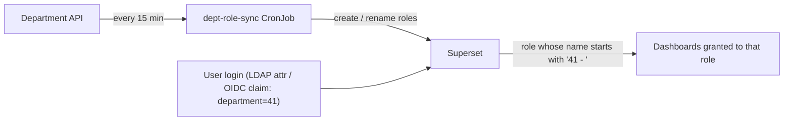

# Department role sync

Keeps Superset roles in step with a department API, so dashboards can be
granted per department.

Each department `{"deptcd": "41", "deptnm": "Văn phòng Đoàn Thanh niên"}`
becomes a Superset role named `41 - Văn phòng Đoàn Thanh niên`. When
`deptnm` changes upstream, the existing role is **renamed in place**: same
role id, so user assignments and dashboard grants survive the rename.
Departments that disappear from the API are left alone (no deletes).

## How it fits together



Three pieces:

1. **`sync_roles.py`** (run by `k8s/cronjob.yaml`) — fetches departments,
   lists Superset roles, matches them to departments by the `"<deptcd> - "`
   name prefix, then creates missing roles and renames changed ones.
   Stdlib only, runs on a stock `python:3.12-alpine`. Idempotent.
2. **A custom security manager** in Superset's config (see
   `../superset-values.yaml`, `DeptRoleSecurityManager`) — overrides
   `get_roles_from_keys` so a user whose `department` attribute is `41`
   gets whichever role *currently* starts with `41 - `. The static
   `AUTH_ROLES_MAPPING` can't do this, because it's keyed by exact role
   name and the name changes on rename. `get_roles_from_keys` is shared
   by Flask-AppBuilder's LDAP and OAuth login paths, so this works the
   same for an OIDC claim.
3. **`DASHBOARD_RBAC` feature flag** — lets an admin grant a dashboard to
   roles (dashboard *Properties → Roles*). No other permissions need to be
   configured on the department roles.

## Deploy

```bash
kubectl create configmap dept-role-sync-script -n default \
  --from-file=sync_roles.py=sync_roles.py --dry-run=client -o yaml | kubectl apply -f -
# edit the Secret's placeholder password first (or patch it after apply)
kubectl apply -f k8s/cronjob.yaml

# run once now instead of waiting for the schedule:
kubectl create job dept-role-sync-manual -n default --from=cronjob/dept-role-sync
```

Point `DEPT_API_URL` / `DEPT_API_TOKEN` at the real API when it's ready. The
script expects the response shape `{"success": true, "data": {"departments":
[{"deptcd": ..., "deptnm": ...}, ...]}}`. Run it locally with `--dry-run` to
preview changes without making them.

## Mock API (for testing)

`mock-api/server.py` serves `mock-api/departments.json` at
`GET /api/departments` (Bearer token required). It re-reads the file on
every request, so editing a `deptnm` there simulates an upstream rename.

```bash
docker run -d --name dept-api --restart unless-stopped -p 8091:8000 \
  -e API_TOKEN=dept-api-test-token \
  -v "$PWD/mock-api":/data:ro -e DATA_FILE=/data/departments.json \
  python:3.12-alpine python /data/server.py
```

## Verified end to end (2026-11-17)

- First sync against the 84-department mock data: `created: 84`.
- Renamed department 41 in the mock JSON, re-synced: `renamed: 1,
  unchanged: 83` — role id 50 stayed id 50, only its name changed.
- LDAP user `dave` with `department: 41` logged in and was given role 50
  under its **new** name; existing static mappings (`bob` → `KHCN`,
  `Region_HN`) unaffected.
- Created a dashboard granted only to role 50: `dave` sees it in the
  dashboard list, `bob` does not.

## Things to know

- **The user's attribute must carry the code exactly as the API sends it**,
  leading zeros included: `06` matches role `06 - ...`, `6` does not.
- **The prefix is the identity.** If someone hand-edits a role in the
  Superset UI and breaks the `"41 - "` prefix, the next sync will create a
  new role for 41. If two roles ever share a prefix, both the sync and the
  login lookup log a warning and skip that code rather than guess.
- **Role names are capped at 64 characters** (`ab_role.name`); longer ones
  are truncated with a warning. The longest in the mock data is 55.
- **`AUTH_ROLES_SYNC_AT_LOGIN` is on**, so a user's roles are rebuilt from
  their attribute at every login — roles added to a user by hand are
  removed on their next login.
- A brand-new department's role exists only after the next sync run (up to
  15 minutes). A user who logs in before that gets no department role
  until their next login after the sync.
